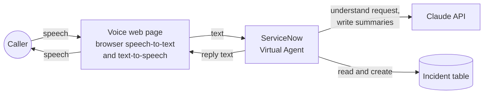

# Athena: an IT Help Desk Voice Agent on ServiceNow

A voice assistant that lets employees check on IT tickets and report new problems by talking, built on ServiceNow Virtual Agent with Claude for language understanding.

This is a portfolio project focused on **conversation design**: persona, flows, error recovery, and the split between what a language model should and shouldn't do.

> **Status:** design complete, ServiceNow connected to Claude, building the conversation next.

## What Athena can do

- **Check ticket status:** "Any update on my laptop ticket?"
- **Report a new issue:** "My VPN keeps dropping." Athena asks a couple of follow-ups, confirms, and logs an incident.
- **Hand off to a person**, with a summary so the caller never repeats themselves.

## How it works

- **Virtual Agent** owns the flow and every read or write to ServiceNow.
- **Claude** interprets free-form speech and writes ticket summaries. It never invents ticket data.
- **The voice page** uses the browser's built-in speech APIs, so it runs free in Chrome.

## Repository layout

| Folder | Contents |
|---|---|
| [`design/`](design/) | Conversation design: [overview](design/01-overview.md), [persona](design/02-persona.md), [flows](design/03-flows.md), [sample dialogues](design/04-sample-dialogues.md) |
| [`docs/setup/`](docs/setup/) | How to set up the project on a ServiceNow developer instance |
| [`docs/build/`](docs/build/) | Step-by-step build guides for each conversation |
| [`servicenow-scripts/`](servicenow-scripts/) | Readable copies of the ServiceNow server scripts (`ClaudeClient`, `AthenaTickets`) |
| [`voice-web/`](voice-web/) | The browser voice front end (coming soon) |
| ServiceNow app | Committed by ServiceNow Studio to the [`sn_instances/dev194736`](../../tree/sn_instances/dev194736) branch (scope `x_2244524_voice_0`) |

## Roadmap

- [x] Conversation design
- [x] Link ServiceNow scoped app to this repo
- [x] Connect ServiceNow to the Claude API
- [ ] Build Virtual Agent topics
  - [ ] Check ticket status ([guide](docs/build/01-check-status-topic.md))
  - [ ] Report a new issue
  - [ ] Hand off to a person
- [ ] Build the voice web page
- [ ] Demo video and write-up
