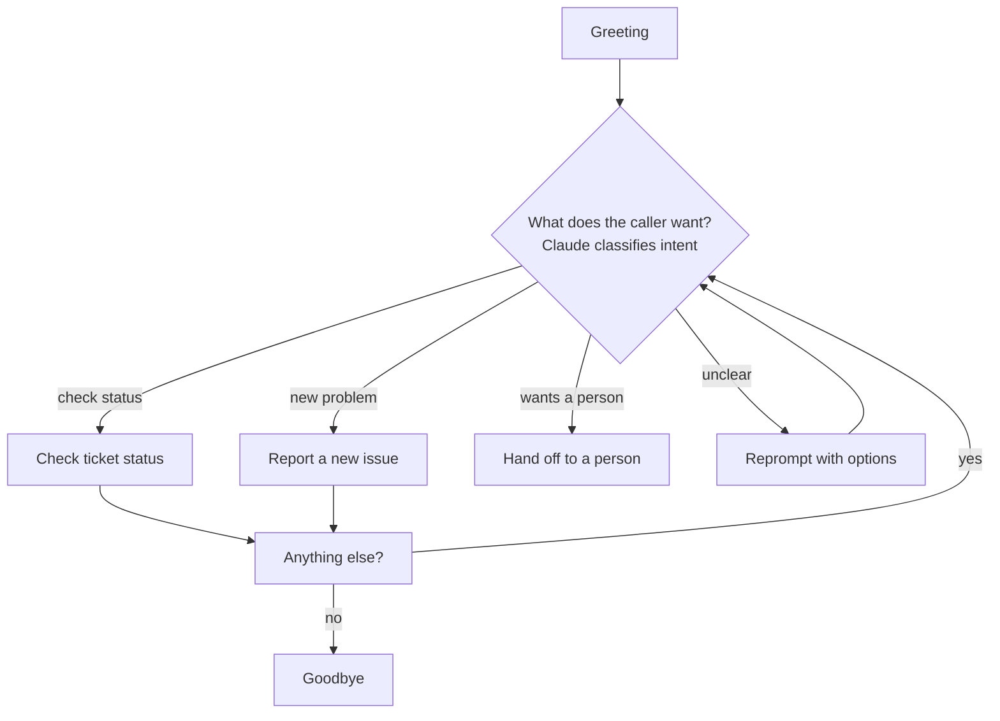
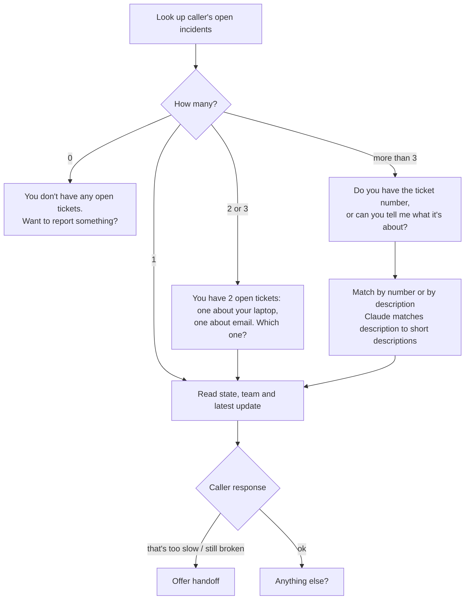
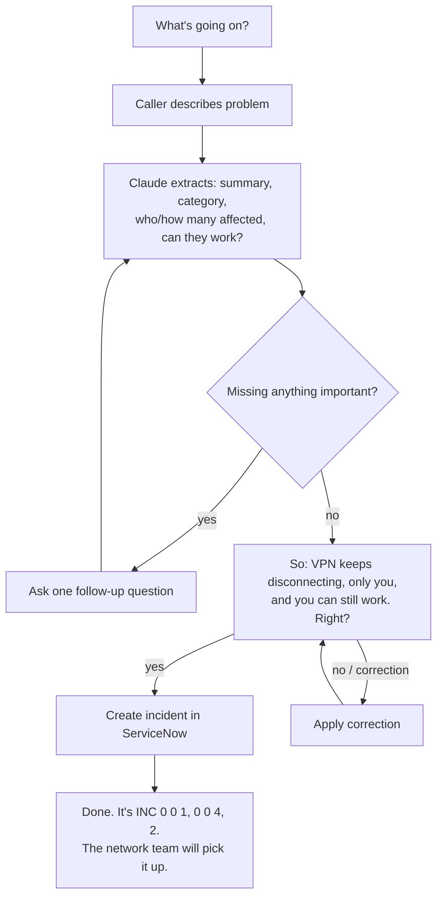

# Conversation Flows and Error Handling

Diagrams use Mermaid, which GitHub renders automatically.

## Top level

## Flow 1: Check ticket status

**Details**
- Lists of two or three are summarised by Claude from each ticket's short description into a few words ("your laptop", "email").
- Athena reads ticket state in plain words. Map ServiceNow states: New → "logged, not picked up yet"; In Progress → "being worked on by the network team"; On Hold → "waiting on something, here's the note".

## Flow 2: Report a new issue

**Slots collected**

| Slot | ServiceNow field | How it's filled |
|---|---|---|
| Summary | `short_description` | Claude writes it from the caller's words, under 80 characters |
| Full description | `description` | Caller's words, lightly cleaned, plus transcript |
| Category | `category` | Claude picks from the instance's category list (hardware, software, network, ...) |
| Impact | `impact` | "Just you, your team, or everyone?" |
| Urgency | `urgency` | "Can you still work, or are you blocked?" |

Ask at most two follow-up questions. If details are still missing, create the ticket anyway and note what's unknown. A caller who gave up halfway is worse than a ticket missing one field.

## Flow 3: Hand off to a person

Triggered by: the caller asking, frustration signals ("this is useless", repeated "no"), three failed attempts, or anything out of scope.

1. Claude writes a three-line summary: what the caller wanted, what was tried, current state.
2. Virtual Agent starts a live agent transfer (or, on the PDI, creates an incident assigned to the service desk with the summary and transcript attached).
3. Athena says what happens next and how long it might take. Never just "transferring".

## Error handling

| Situation | First time | Second time | Third time |
|---|---|---|---|
| **No input** (silence 6s) | "Are you still there? You can say 'check a ticket' or 'report a problem'." | "I'm still here whenever you're ready." | "I'll end here. You can call back any time." |
| **No match** (can't tell what they want) | "Sorry, I didn't catch that. Are you checking a ticket or reporting a problem?" | "I can help with tickets and new problems. For anything else, I can get you a person." | Hand off |
| **Low-confidence ticket number** | "Was that 0 0 1, 0 0 4, 2?" | "Could you say just the last four digits?" | Find by description instead |
| **ServiceNow error / timeout** | "I'm having trouble reaching the system. Let me try again." | Hand off with a note about the error | |
| **Caller interrupts (barge-in)** | Stop speaking immediately and listen | | |
| **Caller corrects Athena** | "Thanks, changing that to ..." then reconfirm | | |

## Guardrails for Claude

- Only states facts about tickets that come from the ServiceNow record in its prompt. If a field is empty, it says it doesn't know.
- Never promises a fix time unless the record has one.
- Out-of-scope requests (passwords, purchases, general questions) get a short "I can't help with that here" and a handoff offer.
- Keeps every response under about 25 words for speech.
